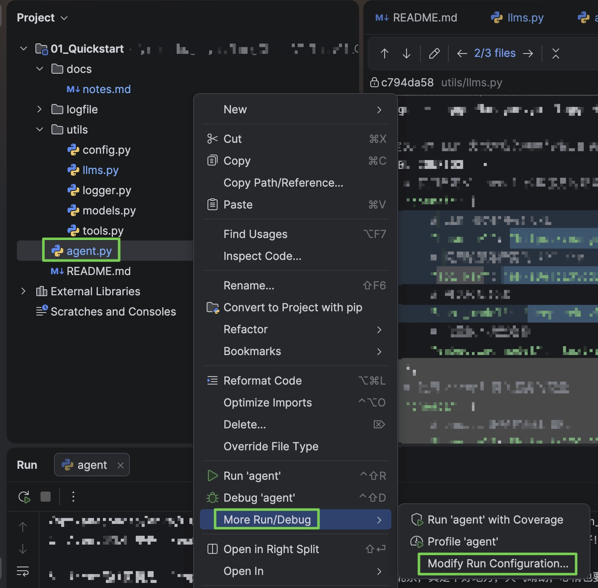
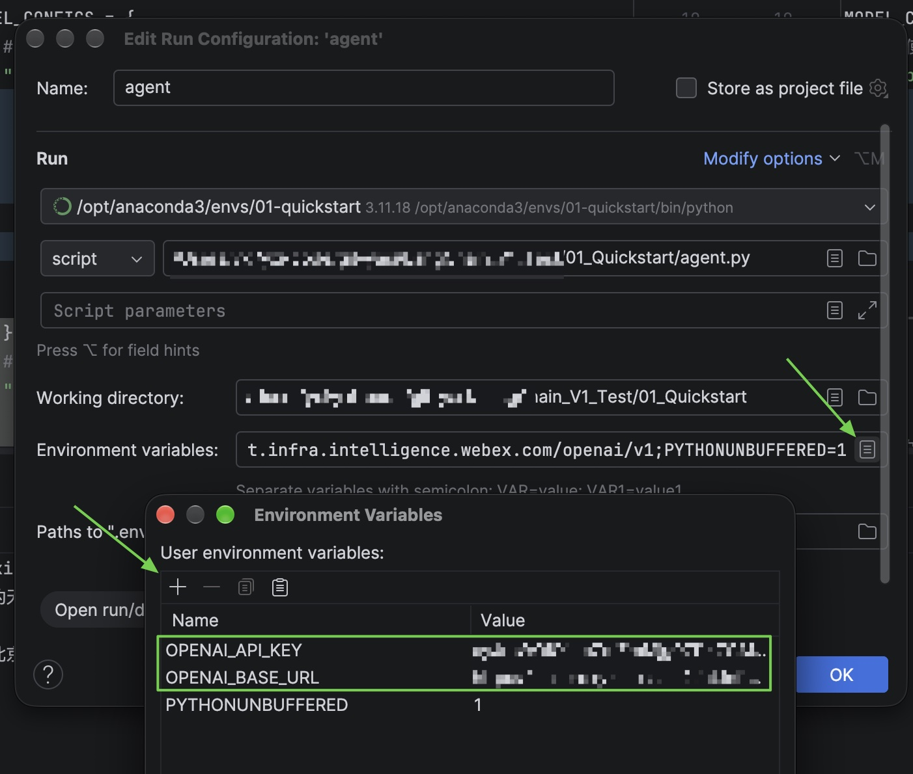

# 项目环境配置与问题排查笔记

## 1. 通过 Anaconda Navigator 选择 Conda 虚拟环境

在 Anaconda Navigator 中打开终端或启动开发工具前，需要先选择项目对应的 Conda 虚拟环境，否则默认使用的是 `base` 环境。

通过 PyCharm 运行 Conda 环境中的 Python，不需要保持 Anaconda Navigator 打开。退出 Navigator 不会删除 Conda 环境，也不会影响 PyCharm 已配置好的解释器。

## 2. 在 PyCharm 中创建 Conda 虚拟环境

可以直接在 PyCharm 的可视化界面中创建 Conda 虚拟环境，无需通过命令行执行 `conda create`。

### 2.1 创建步骤

1. 按 `⌘ ,` 打开设置，搜索 **Python Interpreter／Python 解释器**。
2. 点击 **Add Interpreter → Add Local Interpreter**。
3. 环境类型选择 **Conda**。
4. 选择 **Generate new／New environment（创建新环境）**。
5. 填写以下信息：
   - **Python version**：项目要求的版本，例如 `3.12`。
   - **Environment name**：例如 `knowledge-base`。
   - **Conda executable**：通常会自动识别；如果没有，需要选择本机的 `conda` 可执行文件。
6. 点击 **OK／Create**，等待创建和安装完成。

## 3. 运行 agent.py 时出现依赖版本不兼容

### 3.1 报错现象

在项目根目录执行 `python agent.py` 时，如果出现以下错误，说明 `langgraph` 与 `langgraph-prebuilt` 版本不兼容：

```text
Traceback (most recent call last):
  File "/Users/yxi/yxi-code/git-yasi/LangChain_V1_Test/01_Quickstart/agent.py", line 4, in <module>
    from langchain.agents import create_agent
  File "/opt/anaconda3/envs/01-quickstart/lib/python3.11/site-packages/langchain/agents/__init__.py", line 3, in <module>
    from langchain.agents.factory import create_agent
  File "/opt/anaconda3/envs/01-quickstart/lib/python3.11/site-packages/langchain/agents/factory.py", line 22, in <module>
    from langgraph.prebuilt.tool_node import ToolCallWithContext, ToolNode
  File "/opt/anaconda3/envs/01-quickstart/lib/python3.11/site-packages/langgraph/prebuilt/__init__.py", line 3, in <module>
    from langgraph.prebuilt.chat_agent_executor import create_react_agent
  File "/opt/anaconda3/envs/01-quickstart/lib/python3.11/site-packages/langgraph/prebuilt/chat_agent_executor.py", line 47, in <module>
    from langgraph.prebuilt.tool_node import ToolCallWithContext, ToolNode
  File "/opt/anaconda3/envs/01-quickstart/lib/python3.11/site-packages/langgraph/prebuilt/tool_node.py", line 89, in <module>
    from langgraph.runtime import ExecutionInfo, ServerInfo  # noqa: TC002
    ^^^^^^^^^^^^^^^^^^^^^^^^^^^^^^^^^^^^^^^^^^^^^^^^^^^^^^^
ImportError: cannot import name 'ExecutionInfo' from 'langgraph.runtime' (/opt/anaconda3/envs/01-quickstart/lib/python3.11/site-packages/langgraph/runtime.py)
```

### 3.2 问题原因

`langgraph-prebuilt` 在导入时使用了 `langgraph.runtime.ExecutionInfo`，但当前安装的 `langgraph` 版本没有提供该类型，因此在导入阶段失败。

### 3.3 解决方式

在项目对应的 Conda 环境中，保留教程使用的 `langchain==1.2.1`，将 `langgraph-prebuilt` 降到 `1.0.8`，并固定 `langgraph==1.0.10`：

```bash
python -m pip install "langchain==1.2.1" "langgraph==1.0.10" "langgraph-prebuilt==1.0.8"
```

### 3.4 验证修复结果

在项目根目录依次执行：

```bash
python -m pip check
python -c "from langchain.agents import create_agent; print('导入成功')"
python agent.py
```

`pip check` 用于检查依赖声明是否满足；导入验证用于确认本次 `ImportError` 是否解决；最后运行脚本验证完整流程。

注意：即使 `pip check` 通过，也不能单独证明代码层面的兼容性，因此还需要执行导入验证。

## 4. LangSmith 跟踪上传返回 403 Forbidden

### 4.1 报错现象

如果遇到下面的错误，使用的 proxy 可能不支持或未正确转发 LangSmith 请求。不过，403 也可能由 LangSmith API Key 无效、工作区权限不足或区域配置不匹配引起，不能仅凭这段日志确定是 proxy 问题。

```text
Failed to multipart ingest runs: langsmith.utils.LangSmithError: Failed to POST https://api.smith.langchain.com/runs/multipart in LangSmith API. HTTPError('403 Client Error: Forbidden for url: https://api.smith.langchain.com/runs/multipart', '{"error":"Forbidden"}\n')
Failed to send compressed multipart ingest: langsmith.utils.LangSmithError: Failed to POST https://api.smith.langchain.com/runs/multipart in LangSmith API. HTTPError('403 Client Error: Forbidden for url: https://api.smith.langchain.com/runs/multipart', '{"error":"Forbidden"}\n')
Failed to send compressed multipart ingest: langsmith.utils.LangSmithError: Failed to POST https://api.smith.langchain.com/runs/multipart in LangSmith API. HTTPError('403 Client Error: Forbidden for url: https://api.smith.langchain.com/runs/multipart', '{"error":"Forbidden"}\n')
Agent最终回复是: ResponseFormat(punny_response='北京的天气晴得像个笑话，真是让人心情大好！', weather_conditions='晴天')

...
```

日志中已经输出两次 Agent 回复，说明对话调用成功，失败的是 LangSmith 跟踪数据上传。

### 4.2 解决方法：关闭 LangSmith 跟踪

如果不需要 LangSmith 跟踪，可以修改 `agent.py`，将：

```python
os.environ["LANGCHAIN_TRACING_V2"] = "true"
os.environ["LANGCHAIN_API_KEY"] = "..."
```

改成：

```python
os.environ["LANGCHAIN_TRACING_V2"] = "false"
os.environ["LANGSMITH_TRACING"] = "false"
```

保存后重新执行：

```bash
python agent.py
```
## 5. ResponseFormat 检查点反序列化警告

### 5.1 警告现象

如果运行时遇到下面的信息，说明出现了检查点反序列化警告；日志中已输出两次 Agent 回复，本次对话调用仍然成功：

```text
Agent最终回复是: ResponseFormat(punny_response='北京的天气晴得像个笑话，真是让人心情大好！', weather_conditions='晴天')

Deserializing unregistered type utils.models.ResponseFormat from checkpoint. This will be blocked in a future version. Set LANGGRAPH_STRICT_MSGPACK=true to block now, or add to allowed_msgpack_modules to allow explicitly: [('utils.models', 'ResponseFormat')]
Agent最终回复是: ResponseFormat(punny_response='你现在在北京，真是个好地方，天气也很晴朗，适合出去走走！', weather_conditions=None)
```

### 5.2 问题原因

`ResponseFormat` 是项目自定义的数据类。第一次调用后，它被存入检查点；第二次调用恢复会话时，LangGraph 发现这个类型没有被显式加入允许列表，于是提示：当前仍允许恢复，但未来版本将阻止这种行为。

### 5.3 解决方法：显式允许恢复 ResponseFormat

在 `agent.py` 中先添加导入：

```python
from langgraph.checkpoint.serde.jsonplus import JsonPlusSerializer
```

再将：

```python
checkpointer = InMemorySaver()
```

改为：

```python
checkpointer = InMemorySaver(
    serde=JsonPlusSerializer(
        allowed_msgpack_modules=[
            ("utils.models", "ResponseFormat"),
        ]
    )
)
```

该配置会保留会话记忆，并显式允许反序列化项目中的 `ResponseFormat`。[官方文档](https://reference.langchain.com/python/langgraph.checkpoint/serde/jsonplus/JsonPlusSerializer)

不要只设置 `LANGGRAPH_STRICT_MSGPACK=true`：它会提前启用严格检查，未配置允许列表时可能直接报错。

## 6. 通过环境变量配置模型服务

### 6.1 配置变更

已修改 `utils/llms.py` 中 `MODEL_CONFIGS` 的 `base_url` 和 `api_key`，这两个配置项不再硬编码，改为从环境变量中读取：

```python
"base_url": os.getenv("OPENAI_BASE_URL"),
"api_key": os.getenv("OPENAI_API_KEY"),
```

### 6.2 在 PyCharm 中设置环境变量

1. 在 PyCharm 的项目文件列表中选中 `agent.py`，点击右键。
2. 选择 **More Run/Debug → Modify Run Configuration**。
3. 在 **Environment variables（环境变量）** 中配置以下两个变量的值：

   | 变量名 | 值 |
   |---|---|
   | `OPENAI_BASE_URL` | 模型服务的 API 基础地址 |
   | `OPENAI_API_KEY` | 对应模型服务的 API Key |

4. 保存配置，然后使用该运行配置执行 **Run／Debug**。

操作截图如下：





这里设置的环境变量仅对该运行配置启动的进程生效，不会自动应用到终端中手动执行的 `python agent.py`。

> **注意：** 如果 `OPENAI_BASE_URL` 使用的是 proxy，可能需要配置成类似 `https://example.proxy.com/openai/v1` 的地址。具体路径以代理服务提供的 OpenAI 兼容 API 基础地址为准，不要只填写域名，也不要包含完整的 `/chat/completions` 接口路径。
